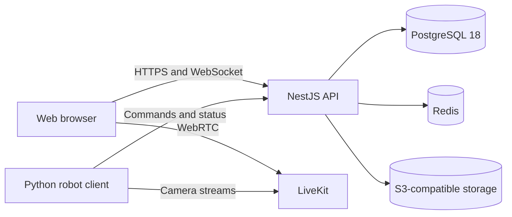

# BotParty

BotParty lets people control camera-equipped robots from a web browser. The server handles accounts, rooms, queues, chat, moderation, and control sessions. A separate Python client runs on each robot and connects its cameras and controls to the server.

BotParty is still under active development.

> [!WARNING]
> Test the emergency stop on the physical robot before opening a room to other users. Start the robot client with `hardware.type: none` until video, authentication, and disconnect handling work as expected.

## What it supports

- WebRTC video through LiveKit, with support for multiple cameras
- Browser controls with acknowledgements, cooldowns, and custom hotkeys
- First-come and voting queues with timed control sessions
- Room chat and live control feedback
- Robot ownership, access rules, moderation, and administrator roles
- Short-lived robot credentials and rejection of stale commands
- PostgreSQL for persistent data, Redis for coordination, and S3-compatible file storage
- Docker Compose deployment, health checks, database migrations, backups, and monitoring

## How it fits together



This repository contains:

- `apps/api` — NestJS API using Fastify
- `apps/web` — Next.js web application
- `packages/prisma` — Prisma schema, migrations, seed data, and generated client
- `packages/shared` — shared validation schemas, protocol types, and constants
- `docker` — container images and service configuration
- `scripts` — migration, backup, smoke-test, and load-test tools
- `docs` — development, operations, protocol, and architecture guides

The robot client is maintained separately at [onlybrezel/botparty-client](https://github.com/onlybrezel/botparty-client).

## Requirements

- Node.js 24
- pnpm 11.21 or later
- Docker Engine with Docker Compose
- Python 3.10 or later on machines running the robot client

Deployment sizes and resource limits are listed in the [system requirements](docs/system-requirements.md).

## Run it locally

```bash
git clone https://github.com/onlybrezel/botparty.git
cd botparty
nvm use
pnpm install
bash setup-env.sh
docker compose -f docker-compose.yml -f docker-compose.dev.yml up -d --build
```

Select **Local development** when `setup-env.sh` asks for a deployment type. The migration container prepares and seeds the database before the API starts.

Open:

- Web app: <http://localhost:3000>
- API: <http://localhost:4000>
- API documentation: <http://localhost:4000/docs>
- LiveKit WebSocket: `ws://localhost:7880`

Check the containers and run the development smoke test:

```bash
docker compose -f docker-compose.yml -f docker-compose.dev.yml ps
pnpm dev:smoke
```

See the [development guide](docs/development.md) for the repository layout, database changes, generated API files, and test commands.

## Connect a robot

Install the [BotParty robot client](https://github.com/onlybrezel/botparty-client) on the computer attached to the robot. Its documentation covers Raspberry Pi setup, cameras, serial hardware, and systemd installation.

Use `hardware.type: none` for the first connection. This keeps motor output disabled while you check the camera stream and connection lifecycle.

## Production

Create the environment file and secrets, run the preflight checks, then start the stack:

```bash
bash setup-env.sh
./ops.sh preflight
docker compose up -d --build
```

Select **Server / VPS** in `setup-env.sh`. The preflight checks TLS files, secrets, image versions, SMTP, backups, alerting, and deployment policy settings.

Read the [production runbook](docs/runbook.md) before putting an instance online. It covers deployment, backups, restores, incidents, and upgrades.

### Upgrade from PostgreSQL 16

PostgreSQL 16 installations need an offline data migration before they can start the PostgreSQL 18 stack:

```bash
pnpm db:upgrade:postgres18
```

The upgrade script dumps the old database, restores it into a new volume, compares row counts, enables data checksums, and leaves the PostgreSQL 16 volume in place for rollback. Follow the [PostgreSQL 16 to 18 procedure](docs/runbook.md#postgresql-16--18-major-upgrade) before running it on a production host.

## Checks

Run the main checks from the repository root:

```bash
pnpm lint
pnpm typecheck
pnpm test
pnpm build
pnpm test:e2e:docker
```

Focused checks:

```bash
pnpm --filter @botparty/api test
pnpm --filter @botparty/web test
pnpm db:verify-migrations
pnpm test:backup
pnpm secrets:smoke
pnpm load:smoke
```

The [documentation index](docs/README.md) links to the remaining setup, protocol, performance, and operations guides.

## Contributing

Issues and pull requests are welcome. Read [CONTRIBUTING.md](CONTRIBUTING.md) before making a change and follow the [Code of Conduct](CODE_OF_CONDUCT.md). Report security problems privately as described in [SECURITY.md](SECURITY.md).

## License

BotParty is licensed under the [MIT License](LICENSE). Third-party packages and services keep their own licenses.
