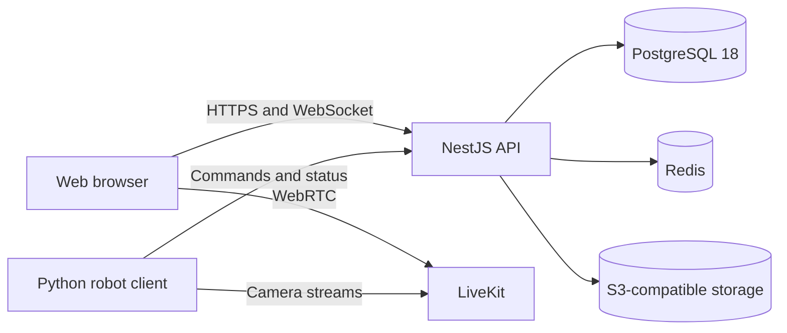

# BotParty

BotParty is a self-hosted platform for controlling camera-equipped robots from a browser. A robot connects through the separate Python client, publishes video through LiveKit, and receives low-latency control commands from the BotParty gateway.

The project is under active development. Test emergency-stop behavior on the physical robot before allowing public access.

## Features

- WebRTC video through LiveKit, including multiple cameras
- Browser controls with acknowledgements, cooldowns, and configurable hotkeys
- First-come and voting queues with timed control sessions
- Room chat and live control feedback
- Robot ownership, access rules, moderation, and role-based administration
- Short-lived robot credentials and stale-command rejection
- PostgreSQL-backed state, Redis coordination, and S3-compatible file storage
- Docker Compose deployment with health checks, migrations, backups, and monitoring

## Architecture



The monorepo contains:

- `apps/api`: NestJS and Fastify API
- `apps/web`: Next.js web application
- `packages/prisma`: schema, migrations, seed, and generated client
- `packages/shared`: shared schemas, protocol types, and constants
- `docker`: service configuration and container images
- `scripts`: migration, backup, smoke-test, and load-test tooling
- `docs`: development, operations, protocol, and architecture documentation

## Requirements

- Node.js 24
- pnpm 11.20 or newer
- Docker Engine with Docker Compose
- Python 3.10 or newer for the separate robot client

See the [system requirements](docs/system-requirements.md) for deployment sizing.

## Local development

```bash
git clone https://github.com/onlybrezel/botparty.git
cd botparty
nvm use
pnpm install
bash setup-env.sh
docker compose -f docker-compose.yml -f docker-compose.dev.yml up -d --build
```

Choose the local development option in `setup-env.sh`. The migration service applies committed migrations and seeds the database before the API starts.

Local endpoints:

- Web: <http://localhost:3000>
- API: <http://localhost:4000>
- Swagger: <http://localhost:4000/docs>
- LiveKit: `ws://localhost:7880`

Check the stack with:

```bash
docker compose -f docker-compose.yml -f docker-compose.dev.yml ps
pnpm dev:smoke
```

## Robot client

The Python client lives in [onlybrezel/botparty-client](https://github.com/onlybrezel/botparty-client). Start with `hardware.type: none` while testing video and connectivity without motors attached. The client repository documents Raspberry Pi setup, camera backends, serial hardware, and systemd installation.

## Production deployment

Generate the environment and file-based secrets first:

```bash
bash setup-env.sh
./ops.sh preflight
docker compose up -d --build
```

The production preflight checks secrets, TLS files, image versions, SMTP, backups, alerting, and deployment-specific policy references. The [production runbook](docs/runbook.md) covers backups, restores, incidents, and upgrades.

### PostgreSQL 16 upgrades

Existing PostgreSQL 16 installations must migrate their data before starting the PostgreSQL 18 stack:

```bash
pnpm db:upgrade:postgres18
```

The script performs an offline dump and restore into a new volume, checks row counts, enables data checksums, and keeps the PostgreSQL 16 source volume for rollback. Read the [major-upgrade procedure](docs/runbook.md#postgresql-16--18-major-upgrade) before running it on a production host.

### Release images

SemVer tags publish API and web images to GitHub Container Registry:

```bash
git tag v0.1.4
git push origin v0.1.4
```

Production deployments should set `APP_VERSION` to a release tag instead of using a moving tag.

## Development commands

```bash
pnpm lint
pnpm typecheck
pnpm test
pnpm build
pnpm test:e2e:docker
```

Useful focused commands:

```bash
pnpm --filter @botparty/api test
pnpm --filter @botparty/web test
pnpm db:verify-migrations
pnpm test:backup
pnpm secrets:smoke
pnpm load:smoke
```

The [developer guide](docs/development.md) explains module ownership, database changes, API artifacts, and release checks. The [documentation index](docs/README.md) lists the remaining guides.

## Contributing

Bug reports and pull requests are welcome. Read [CONTRIBUTING.md](CONTRIBUTING.md), follow the [Code of Conduct](CODE_OF_CONDUCT.md), and use [SECURITY.md](SECURITY.md) for private vulnerability reports.

## License

BotParty is available under the [MIT License](LICENSE). Third-party dependencies remain subject to their own licenses.
