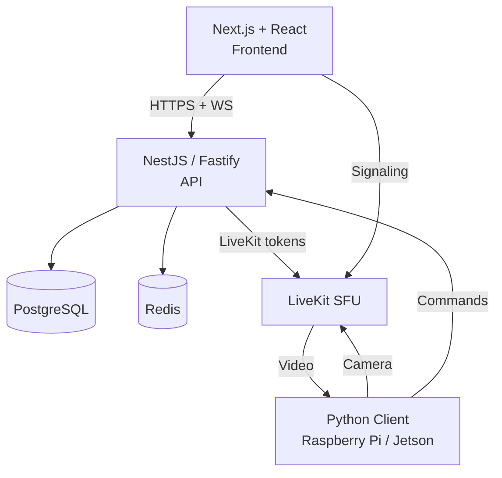

# BotParty

Self-hosted robot teleoperation platform.

Plug in a Raspberry Pi (or any Linux box with Python and a camera), claim it from the dashboard, and let people drive it live from a browser.

Inspired by LetsRobot.tv and Remo.tv. Written with a modern stack when the time felt right.

---

## What works right now

- **Live video** via LiveKit SFU (WebRTC) — ~150ms end-to-end on a decent connection
- **Control commands** over the BotParty gateway WebSocket — ~50ms round-trip locally
- **Queue system** — first-come-first-serve, configurable turn time
- **Chat** — in-room messaging between the driver and viewers
- **Crowd echo** — everyone sees button presses as they happen
- **Configurable control buttons** — label, hotkey, icon, cooldown, per-robot
- **RBAC** — Admin, Mod, User roles
- **Emergency stop** — ESC key or automatic at >300ms latency
- **Robot dashboard** — visibility, access mode, queue settings
- **Python robot client** — runs on Pi, Jetson, anything with a camera and serial port
- **Password reset via email** — expiring reset links over SMTP
- **Docker deployment** — single `docker compose up -d`

---

## Security

- Responsible disclosure policy: [SECURITY.md](SECURITY.md)

---

## Architecture

The system is deliberately split: browser frontend, backend API, real-time media via LiveKit, and the Python client that actually drives the hardware.



In practice we see:
- ~150 ms end-to-end video latency on a decent connection
- ~50 ms control round-trip when running locally
```
---

## 📁 Project Structure

```
botparty/
├── apps/
│   ├── api/                # NestJS 11 backend (Fastify 5)
│   │   └── src/
│   │       ├── auth/       # JWT + Passport + Argon2
│   │       ├── robots/     # Robot CRUD + settings
│   │       ├── sessions/   # Session management
│   │       ├── queue/      # Queue system (FCFS, voting)
│   │       ├── livekit/    # LiveKit token generation
│   │       ├── gateway/    # WebSocket gateway (ws)
│   │       ├── users/      # User management
│   │       ├── health/     # Health checks
│   │       ├── prisma/     # Prisma service
│   │       └── redis/      # Redis service
│   ├── web/                # Next.js 15+ frontend
│   │   └── src/
│   │       ├── app/        # App Router pages
│   │       └── lib/        # API client, utils
│   └── robot-client/       # Python robot client (moved to botparty-client repo)
├── packages/
│   ├── shared/             # Shared types, Zod schemas, constants
│   ├── prisma/             # Prisma schema + client
│   ├── tsconfig/           # Shared TypeScript configs
│   └── eslint-config/      # Shared ESLint config
├── docker/
│   ├── api/Dockerfile      # Multi-stage API build
│   ├── web/Dockerfile      # Multi-stage Web build
│   ├── nginx/nginx.conf    # Reverse proxy + security
│   └── livekit/livekit.yaml
├── docker-compose.yml
├── turbo.json
├── pnpm-workspace.yaml
└── package.json
```

---

## Quick Start

### Prerequisites
- Node.js 24, pnpm 9.15+
- Docker & Docker Compose
- Python 3.10+ (robot client only)

Use `nvm use`, `asdf`, or `mise` before installing dependencies. This repository enforces the Node version from `.nvmrc` / `.node-version` and will fail installs on unsupported runtimes.

### Local development

```bash
git clone https://github.com/onlybrezel/botparty.git
cd botparty
nvm use
pnpm install
```

Start the database, cache, and LiveKit:

```bash
docker compose up -d postgres redis livekit
```

Set up the environment (defaults work for local dev):

```bash
cp .env.example .env
```

Generate the Prisma client, push the schema and seed demo data:

```bash
pnpm db:generate
pnpm db:push
pnpm --filter @botparty/prisma db:seed
```

Start everything with hot reload:

```bash
pnpm dev
```

- Frontend: http://localhost:3000
- API: http://localhost:4000
- Swagger: http://localhost:4000/docs (dev only)
- Generated API client docs: `pnpm docs:api-client` -> `docs/api-client.md`
- Generated TypeScript client: `pnpm generate:ts-api-client` -> `apps/web/src/lib/generated/openapi-client`
- LiveKit: ws://localhost:7880

---

## Robot client (Raspberry Pi)

The robot client is in a separate repo: [botparty-client](https://github.com/onlybrezel/botparty-client).

A typical local setup (adjust paths to your checkout):

```bash
cd /path/to/botparty-client
python3 -m venv .venv
source .venv/bin/activate
pip install -e ".[all]"
cp config.example.yaml config.yaml
# edit claim_token, hardware.type, video.type etc.
python -m botparty_robot
```

Key config:

- `server.claim_token` from the dashboard (or `BOTPARTY_CLAIM_TOKEN` env)
- `server.api_url` / `livekit_url` matching your instance
- `hardware.type` (start with `none` for video tests)
- `video.type` ( `ffmpeg` recommended, it auto-manages the low-latency streamer)

See the client repo README and docs for full install script, Raspberry Pi gotchas, custom hardware, multi-camera, TTS etc.

The one-command installer there also sets up a systemd service if you want.

---

## Production Deployment

Run the setup wizard first — it generates `.env`, sets up URLs and secrets, and optionally configures HTTPS:

```bash
bash setup-env.sh
```

Then:

```bash
docker compose up -d --build
```

The API container runs `prisma migrate deploy` and then seeds an empty database when `SEED_ADMIN_PASSWORD` is provided. Check logs with `docker compose logs -f api`.

For faster iteration, build or start only changed parts:

```bash
pnpm docker:build:api
pnpm docker:build:web
pnpm docker:build:app
pnpm docker:up:core
pnpm docker:up:app
```

### SSL with Let's Encrypt

The setup wizard walks through this, but the short version:

1. Point your domain's A record, e.g. `botparty.live`, at the server.
2. Run `bash setup-env.sh` and choose "Let's Encrypt" when asked.
3. The script sets up the nginx config and tells you the certbot command to run.
4. Certificates go in `docker/nginx/ssl/` — nginx picks them up automatically.

### SSL with your own certs

Copy `fullchain.pem` and `privkey.pem` into `docker/nginx/ssl/`, then run `bash setup-env.sh` and choose "Own certificates".

### Tagged releases via GHCR

Release images are published from SemVer git tags:

```bash
git tag v0.1.4
git push origin v0.1.4
```

This triggers `.github/workflows/release.yml`, which publishes:

- `ghcr.io/<owner>/botparty-api:v0.1.4`
- `ghcr.io/<owner>/botparty-web:v0.1.4`

`docker-compose.yml` already uses registry-based image names through `IMAGE_REGISTRY`, `IMAGE_NAMESPACE`, and `APP_VERSION`, so production hosts can deploy a pinned release with:

```bash
export IMAGE_NAMESPACE=onlybrezel
export APP_VERSION=v0.1.4
docker compose pull api web
docker compose up -d api web nginx
```

---

## Security notes

- JWT access tokens (15 min) + refresh tokens (7d), Argon2id password hashing
- Password reset tokens are one-time, expire by TTL, and invalidate older reset emails
- RBAC: Admin → Mod → User
- Rate limiting on both nginx and NestJS sides (auth tighter than general API)
- Strict CORS origin list
- Security headers via nginx (X-Frame-Options, CSP, etc.)
- Zod validation on all API inputs
- Emergency stop fires automatically at >300ms latency

---

## Database models

- **User** — roles, credits, refresh tokens
- **Robot** — all settings: visibility, access, queue mode, streaming config
- **Session** — active/ended control sessions
- **QueueEntry** — control queue
- **ChatMessage** — in-room messages
- **ControlButton** — per-robot configurable controls
- **RobotModerationEntry** — bans and timeouts per robot
- **Transaction** — credit ledger (for future priority queue / features)

---

## Open areas

- Better queue balancing and voting
- ROS2 integration
- More community / leaderboard features
- Credit and priority queue system (schema is there, UI and billing wiring missing)

---

## Contributing

PRs welcome. Open an issue first if it's a bigger change.

- Contribution guide: [CONTRIBUTING.md](CONTRIBUTING.md)
- Current release notes: [CHANGELOG.md](CHANGELOG.md)

---

## License

MIT
